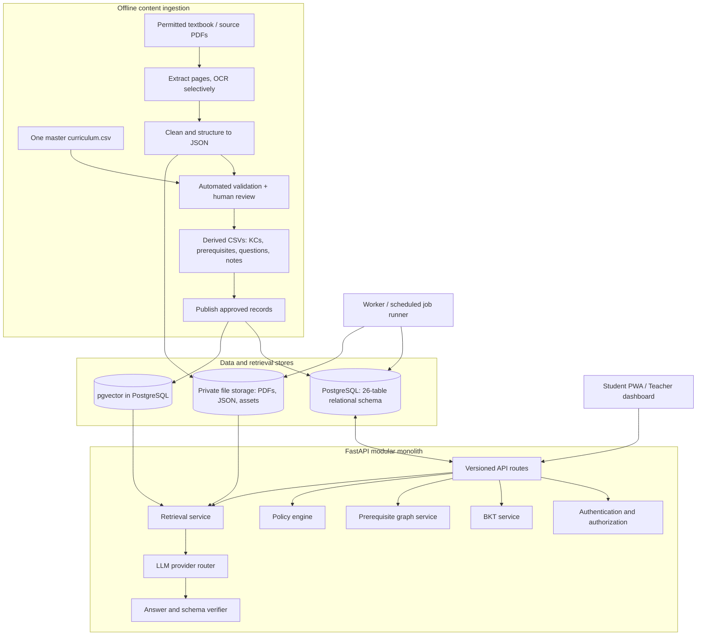

# ConceptTrail — CBSE Classes 6–10 Adaptive Learning Platform

> **Purpose of this repository pack:** provide a single, actionable engineering specification for a Claude Code agent working in a VS Code workspace. It defines the product scope, architecture, database contract, data pipeline, API boundaries, AI-provider strategy, tests, and implementation sequence. It is a specification pack, not a claim that all application code has already been implemented.

## 1. Project mission and Claude Code scope

**Frontend ownership boundary:** the user will develop the frontend separately. Claude Code must not create, scaffold, design or modify frontend pages, components, CSS, browser state, PWA screens or service workers. It may inspect existing frontend files read-only during Phase 0. Claude Code is responsible for all backend, database, data-pipeline, teammate CSV cleaning, AI/RAG, BKT, graph/policy, teacher services, tests, evaluation and deployment work, and must provide OpenAPI plus `docs/FRONTEND_INTEGRATION.md`. A frontend is not required to pass backend phase gates.


ConceptTrail is an AI-assisted and adaptive learning platform for students in **CBSE Classes 6–10** across the agreed initial subject scope:

- English
- Hindi
- Mathematics
- Science
- Social Science

The platform should help learners understand concepts, ask curriculum-grounded doubts, practise, receive feedback, and revisit prerequisite skills. Teachers should be able to inspect class learning signals and review suggested classroom activities, including teacher-reviewed classroom activities such as the Bell-Ringer workflow specified in the supplied ConceptTrail README.

The permanent architecture must be class- and subject-neutral. A limited pilot (for example, a Maths prerequisite chain plus a small non-Maths content sample) is only an engineering validation slice. Never describe the platform as a Class 8 Maths-only system or equate a pilot with full curriculum coverage.

## 2. Product and architecture principles

1. **One relational source of truth:** PostgreSQL stores structured curriculum records, source metadata, content units, KCs, prerequisite edges, questions, users, attempts, mastery state, and ingestion records.
2. **One master curriculum CSV:** the team maintains one cleaned `data_pipeline/curriculum.csv`. Do not add a parallel `resources.csv` or `sources.yaml` as a second master inventory. Resource metadata belongs in the master CSV and is normalised into `source_document` during import.
3. **PDFs and JSON are separate pipeline artifacts:** the user copies original PDFs into `resources/textbook_pdfs/`; intake snapshots are retained privately; extraction stages produce page-aware JSON; cleaned and structured JSON remains inspectable; approved records are published to PostgreSQL.
4. **Teammate CSVs get a dedicated cleaning workflow:** copy originals into `resources/teammate_csv/incoming/`; profile before cleaning; preserve original bytes; write accepted and rejected rows, reports and manifests separately; cross-check against PDFs only when local processing rights are clear. The teammate CSV is not automatically the master curriculum inventory.
5. **Derived CSVs are generated outputs:** `kc_components.csv`, `prerequisites.csv`, `questions.csv`, and a fourth output (currently proposed as `notes.csv`; confirm before freezing) are reproducible outputs, not competing masters.
6. **Retrieval is not training:** extraction, chunking, embedding/indexing, BKT updates, BKT parameter fitting, and LLM fine-tuning are different activities.
7. **No LLM training for the first release:** use a pretrained LLM with RAG. BKT is the adaptive-learning model in the current product design. Fit BKT parameters only when lawful, suitable learner-response sequences and evaluation data exist.
8. **LLMs do not own deterministic decisions:** Python services own answer scoring where deterministic, BKT calculations, graph validation/traversal, permission checks, policy rules, and publication gates.
9. **Human review is required where automation cannot reliably validate academic meaning:** generated KCs, prerequisite edges, open-ended questions, language/literature content, maps, diagrams, and uncertain OCR need review.
10. **Rights before processing:** public downloadability does not imply permission to extract for product use, send content to an external model, index, train on, display, or redistribute it.
11. **Modular monolith first:** one FastAPI application, one PostgreSQL database, one selected vector backend (pgvector is installed in the user's local PostgreSQL), and background jobs only where needed. Do not introduce microservices, Kafka, Kubernetes, or a separate graph database without measured need.

## 3. Status: confirmed, proposed, and unresolved

### User-reported as completed

- The user has pgAdmin on Windows.
- PostgreSQL 18 is installed locally through the official Windows installer.
- pgvector 0.8.7 was compiled and installed on PostgreSQL 18 using Visual Studio x64 Native Tools and `nmake`.
- `CREATE EXTENSION vector` succeeded in the ConceptTrail database.
- A vector cast and cosine-distance test query succeeded.
- The user ran the 26-table SQL schema script and reported all post-creation verification queries returned expected results.

These are **user-reported outcomes**; this package has not connected to or independently inspected the user's local PostgreSQL server. Claude Code must inspect the actual database/schema before attempting migrations.

### Documented product design (not proof of implementation)

- BKT estimates learner mastery per Knowledge Component (KC).
- A prerequisite graph identifies skills that support other skills and helps surface possible root gaps.
- Deterministic policy logic selects the next learning action.
- RAG retrieves approved source material before an LLM drafts an explanation.
- The supplied ConceptTrail README specifies a teacher-facing Bell-Ringer draft workflow with coverage checks and teacher approval; it is an intended feature, not evidence of an effective intervention.
- The attached README specifies adaptive practice policies, misconception-aware feedback, class progress/teacher views, multilingual retrieval and content handling.

### Not verified from source code

No application source repository, dependency lockfile, migration history, test suite, or deployment configuration was supplied for code inspection. Treat all proposed routes, modules, and folder contents below as implementation targets until confirmed in the actual working repository.

### Source-document gap

The user-designated attached `README.md` is the project-context source used for this package revision. The selection PPT/deck is intentionally not used as an input. No separate PRD, application source repository, frontend source, dependency lockfile, migration history, or deployed API was supplied for audit. The user will develop the frontend separately; Claude Code is backend/data/AI/pipeline-only. The context README is a product/engineering specification, not proof of implementation. The documents in `docs/` mark which statements are design and which are implemented and tested; do not treat a design statement as implemented.

## 4. Target architecture



### Runtime question flow

1. Authenticate the user; derive the learner ID from the authenticated session, never trust a client-supplied learner ID as identity.
2. Validate class, subject, course/language and optional chapter context against the published curriculum.
3. Retrieve relevant learner/KC state and relevant prerequisite relationships only when the feature needs them.
4. Use deterministic policy logic to decide whether to answer, retrieve, ask a clarification, serve an approved note, or abstain/escalate.
5. Retrieve chunks only from approved, rights-eligible content and apply hard filters for class, subject, curriculum version, language, source status, and review status.
6. Send only the minimum required context to the configured LLM provider.
7. Validate output structure, source IDs, and subject-specific checks. Do not accept model-invented citations.
8. Return an answer with database-derived source references or a transparent insufficient-evidence response.

### Assessment and BKT flow

1. The API loads the canonical question and its version from PostgreSQL.
2. The server grades using the question's scoring method; never trust a client-supplied `correct` flag.
3. Insert an immutable attempt with an idempotency key.
4. Resolve mapped KCs through `question_kcs`.
5. Apply the explicitly defined per-KC scoring/evidence policy. Multi-KC questions require a reviewed mapping/scoring rule; do not blindly apply the same overall binary result to every KC.
6. Update the corresponding `student_kc_state` rows in the same transaction as the attempt, and record the BKT config version used.
7. Let `policy_engine` select the next action; quiz-score thresholds and BKT probabilities are different values and must not be conflated.

### Teacher Bell-Ringer flow

Use a scheduled/background job or explicit teacher action, not a normal dashboard GET request. Check response coverage and minimum group size before generating. If evidence is insufficient, report that fact and use the documented alternative (such as a short paper check) rather than fabricating a class diagnosis. Generate a draft from approved evidence, validate it, and require teacher review/approval before classroom use.

## 5. Technology stack

| Layer | Baseline choice | Notes |
|---|---|---|
| Language | Python 3.11+ (support-tested range in `pyproject.toml`) | Use a virtual environment. |
| HTTP backend | FastAPI + Uvicorn | Modular monolith; version routes under `/api/v1`. |
| Request/response validation | Pydantic v2 | Distinct from SQLAlchemy ORM models. |
| Relational database | PostgreSQL 18 (user's local setup) | PostgreSQL is the source of truth. |
| Vector extension | pgvector 0.8.7 (user-reported installed) | Extension is enabled per database. |
| ORM / DB driver | SQLAlchemy 2.x + Psycopg 3 | Use connection pooling and request-scoped sessions. |
| Migrations | Alembic | Baseline an existing schema only after introspection. |
| PDF extraction | PyMuPDF | Text-native PDF first; OCR only when needed. |
| OCR | Tesseract (optional, separately installed) | OCR output requires review; language packs vary. |
| Data handling | Python stdlib + Pydantic; pandas only where useful | Avoid unnecessary dataframe dependency for every stage. |
| Graph | NetworkX initially | Store edges relationally; no graph database in v1. |
| Math verification | Deterministic Python checks; SymPy for constrained symbolic tasks | Never use unrestricted `eval` on model output. |
| LLM provider layer | Provider-neutral adapter. Primary: Qwen 3.5 9B (`qwen3.5:9b`) through local Ollama. Fallback candidate: GPT-OSS 120B (`openai/gpt-oss-120b`) through Groq, **automatic fallback disabled**. Gemini and DeepSeek are not selected. The embedding model is undecided. (D-055) | Configure exact model IDs via environment variables; do not enable fallback until it passes the acceptance gates and the owner approves. No adapter is implemented yet. No free/unlimited guarantee. |
| Embeddings | Not selected yet | Benchmark English/Hindi (and other explicitly approved languages) before choosing model and dimension. |
| Vector storage | pgvector | Keep unbounded `VECTOR` schema from current ERD until dimension is approved; vector index later. |
| Testing | pytest, pytest-asyncio, HTTPX test client | Unit, integration, E2E, data and retrieval tests. |
| Code quality | Ruff | Formatting and linting; add type checking when baseline code is stable. |
| Local orchestration | pgAdmin / PostgreSQL installer already used; optional Docker Compose | Do not force Docker if local PostgreSQL is already working. |

## 6. Repository structure

The target layout is intentionally simple. Add files only when a working feature needs them.

```text
concepttrail/
├── .vscode/
│   ├── extensions.json
│   ├── settings.json
│   └── tasks.json
├── app/
│   ├── api/
│   │   ├── v1/
│   │   │   └── README.md
│   │   └── README.md
│   ├── core/
│   │   └── README.md
│   ├── db/
│   │   ├── migrations/
│   │   │   └── README.md
│   │   ├── repositories/
│   │   │   ├── .gitkeep
│   │   │   └── README.md
│   │   ├── models.py
│   │   ├── README.md
│   │   └── session.py
│   ├── schemas/
│   │   └── README.md
│   ├── services/
│   │   └── README.md
│   ├── __init__.py
│   ├── CLAUDE.md
│   └── README.md
├── data_pipeline/
│   ├── data/
│   │   ├── final/
│   │   │   ├── .gitkeep
│   │   │   ├── kc_components.csv
│   │   │   ├── notes.csv
│   │   │   ├── prerequisites.csv
│   │   │   ├── questions.csv
│   │   │   └── README.md
│   │   ├── interim/
│   │   │   ├── csv_profiles/
│   │   │   │   └── README.md
│   │   │   ├── extracted_json/
│   │   │   │   ├── .gitkeep
│   │   │   │   └── README.md
│   │   │   └── README.md
│   │   ├── logs/
│   │   │   ├── csv_cleaning/
│   │   │   │   └── README.md
│   │   │   ├── .gitkeep
│   │   │   └── README.md
│   │   ├── overrides/
│   │   │   ├── csv_cleaning/
│   │   │   │   └── README.md
│   │   │   ├── .gitkeep
│   │   │   └── README.md
│   │   ├── processed/
│   │   │   ├── csv_cleaning/
│   │   │   │   └── README.md
│   │   │   ├── textbook_json/
│   │   │   │   ├── .gitkeep
│   │   │   │   └── README.md
│   │   │   └── README.md
│   │   ├── raw/
│   │   │   ├── teammate_csv/
│   │   │   │   └── README.md
│   │   │   ├── textbooks/
│   │   │   │   ├── .gitkeep
│   │   │   │   └── README.md
│   │   │   └── README.md
│   │   └── README.md
│   ├── prompts/
│   │   ├── .gitkeep
│   │   └── README.md
│   ├── stages/
│   │   ├── __init__.py
│   │   └── README.md
│   ├── CLAUDE.md
│   ├── config.yaml
│   ├── curriculum.csv
│   └── README.md
├── db/
│   ├── schema/
│   │   ├── 001_initial_schema.sql
│   │   └── README.md
│   ├── README.md
│   └── verify_schema.sql
├── deploy/
│   ├── compose.yaml
│   ├── Dockerfile
│   └── README.md
├── docs/
│   ├── AI_AND_PROVIDER_STRATEGY.md
│   ├── API_CONTRACTS.md
│   ├── ARCHITECTURE.md
│   ├── CLAUDE_CODE_WORKFLOW.md
│   ├── CSV_CLEANING_SPEC.md
│   ├── DATA_PIPELINE.md
│   ├── DATABASE_SCHEMA.md
│   ├── FRONTEND_INTEGRATION.md
│   ├── IMPLEMENTATION_ROADMAP.md
│   ├── README.md
│   ├── REQUIREMENTS_TRACEABILITY.md
│   ├── PROVIDER_READINESS.md
│   ├── PUBLIC_DECISIONS.md
│   ├── PUBLICATION_AND_REPRODUCIBILITY.md
│   ├── RISKS_AND_DECISIONS.md
│   ├── SECURITY_PRIVACY.md
│   └── TROUBLESHOOTING.md
├── evaluation/
│   ├── reports/
│   │   └── .gitkeep
│   └── README.md
├── resources/
│   ├── teammate_csv/
│   │   ├── incoming/
│   │   │   └── README.md
│   │   └── README.md
│   ├── textbook_pdfs/
│   │   └── README.md
│   └── README.md
├── tests/
│   ├── e2e/
│   │   └── .gitkeep
│   ├── fixtures/
│   │   └── .gitkeep
│   ├── integration/
│   │   └── .gitkeep
│   ├── unit/
│   │   └── .gitkeep
│   └── README.md
├── training/
│   ├── llm_finetuning/
│   │   ├── .gitkeep
│   │   └── README.md
│   └── README.md
├── .env.example
├── .gitignore
├── CLAUDE.md
├── PACKAGE_CONTENTS.txt
├── PACKAGE_MANIFEST.json
├── pyproject.toml
└── README.md
```

The ZIP includes module README files and placeholders. Claude Code should create source files incrementally; it must not create a large set of empty modules merely because a directory appears in the target tree.

## 7. Database contract: 26 tables

The user-provided ER model and the SQL bootstrap script already run by the user are the baseline. Table names are created in the PostgreSQL schema `concepttrail` in lowercase. The 26 tables are:

1. `subject`
2. `curriculum_version`
3. `source_document`
4. `curriculum_item`
5. `content_unit`
6. `knowledge_component`
7. `content_unit_kcs`
8. `kc_curriculum_map`
9. `kc_edge`
10. `questions`
11. `question_kcs`
12. `question_options`
13. `note`
14. `users`
15. `learners`
16. `role`
17. `user_roles`
18. `attempts`
19. `bkt_config_version`
20. `student_kc_state`
21. `embedding_chunk`
22. `ingestion_job`
23. `ingestion_job_documents`
24. `classroom`
25. `class_enrollments`
26. `teacher_class_assignments`

### Critical schema consistency notes

- The SQL the user executed used `VARCHAR` IDs for `subject.subject_id` and matching subject foreign keys, as shown in the supplied ER schema. An earlier discussion suggested an integer surrogate key. Do not silently convert the live database. If the team still wants integer IDs, prepare and review a dedicated migration that updates every referencing FK and all CSV import mappings.
- `embedding_chunk` follows the supplied design: `chunk_id UUID PK`, `content_unit_id VARCHAR FK`, `chunk_order INTEGER`, `chunk_text TEXT`, `token_count INTEGER`, `embedding_model_id VARCHAR`, `embedding VECTOR`, `index_generation VARCHAR`, `created_at TIMESTAMPTZ`. Do not add `source_document_id`, page number, dimensions, content hash, or JSON metadata to this table unless the user approves a schema revision. Page/provenance data remain available through `content_unit` and `source_document`.
- The current vector column is unbounded `VECTOR` because the embedding model and dimension have not been selected. Do not create a dimension-specific HNSW/IVFFlat index until the model is benchmarked and its output dimension is fixed.
- The bootstrap SQL in `db/schema/001_initial_schema.sql` is for a clean database/schema and is a reference snapshot. The user reports already creating the 26 tables. Do not run this script again against that populated schema. Inspect it first and baseline Alembic safely.
- The earlier bootstrap script did not add `NOT NULL` to every foreign key. Do not claim diagram participation is enforced merely because an FK exists. For each total-participation relationship, decide and migrate `NOT NULL` only after checking actual data and approving the rule.

See `docs/DATABASE_SCHEMA.md` and `db/README.md` for details.

## 8. Master curriculum CSV and source files

### One master file only

Canonical file: `data_pipeline/curriculum.csv`. It has exactly 29 columns in the agreed order.

Do not create a parallel `resources.csv` or `sources.yaml` master inventory. Put resource fields in this one CSV; import logic normalises them into `source_document`, `curriculum_version`, `curriculum_item`, and `subject` rows.

Required agreed columns, in this order:

```text
inventory_id,class_level,board,academic_session,subject_id,course_or_language,item_type,chapter_or_unit_code,chapter_title,topic_title,learning_objective,resource_title,source_id,source_url,publication_or_revision,rights_status,permitted_processing,permitted_indexing,permitted_training,permitted_display,permission_reference,acquired_at,sha256,extraction_status,validation_status,review_status,index_status,last_verified_at,notes
```

The current schema's `subject_id` is a string code because the executed ERD/DDL uses `VARCHAR`; keep this mapping stable until an approved integer-ID migration is made. Values must identify one of the five agreed subject families and the relevant course/language. Do not assume every course/subject is available in every class or that all language variants are the same.

### Scope matrix

Track all 25 initial combinations: Classes 6, 7, 8, 9, 10 crossed with English, Hindi, Mathematics, Science, Social Science. Each row/chapter must show source, academic session, source revision, rights state and processing state. Empty, unavailable, ambiguous and rights-held items remain visible; never remove them from coverage totals.

The 2026–27 session is the working inventory target discussed with the user. Verify each class and course against current official CBSE curriculum material and the relevant textbook; do not treat a reprint date alone as proof of curricular alignment. For Classes 9–10, verify actual English/Hindi course variants. Any additional language or skill subject is out of the currently agreed five-subject core unless the product owner confirms it.

### Derived CSVs

Generate outputs from validated `curriculum.csv` and reviewed extraction records. Explicitly named outputs are:

- `kc_components.csv`
- `prerequisites.csv`
- `questions.csv`
- `notes.csv` is the proposed fourth output name; keep it configurable and confirm the final fourth artifact with the owner before freezing its columns.

The relational model also needs mappings for `content_unit_kcs` and `kc_curriculum_map`; these can be pipeline-generated/import artifacts later. They must not become separate master inventories.

### Textbook files and JSON

- Original PDF drop-zone: `resources/textbook_pdfs/`; immutable source snapshot: `data_pipeline/data/raw/textbooks/<source_id>/<edition>/`.
- Original teammate CSV drop-zone: `resources/teammate_csv/incoming/`; immutable snapshot: `data_pipeline/data/raw/teammate_csv/<dataset_slug>/<sha256>/`.
- CSV profile reports: `data_pipeline/data/interim/csv_profiles/<dataset_slug>/<run_id>/`.
- Accepted/rejected cleaned CSVs: `data_pipeline/data/processed/csv_cleaning/<dataset_slug>/<run_id>/`.
- CSV run logs/quality report: `data_pipeline/data/logs/csv_cleaning/<dataset_slug>/<run_id>/`.
- **Superseded 2026-10-31 (D-030):** the implemented teammate CSV pipeline writes profiles, cleaned, rejected and quarantined rows, reports and manifests to `resources/teammate_csv/processed/`, and mappings and merge proposals to `resources/teammate_csv/mappings/`. The raw snapshot location above is unchanged.
- Raw page extraction: `data_pipeline/data/interim/extracted_json/`.
- Cleaned/structured textbook JSON: `data_pipeline/data/processed/textbook_json/`.
- Human corrections: `data_pipeline/data/overrides/`.
- Logs/diagnostics: `data_pipeline/data/logs/`.
- Derived/release exports: `data_pipeline/data/final/`.

Keep raw extracted output immutable. Cleaning and structuring create new versions. JSON must preserve `source_id`, class, subject, language/course, curriculum version, PDF page index, printed page label when available, chapter/section boundaries, question numbering, equations, tables, diagrams/maps/figure references, extraction method, validation status and review status.

## 9. AI architecture and provider decisions

### Recommended first version

- Existing hosted LLM provider(s) for language generation; no LLM from-scratch training.
- RAG over approved and reviewed content for curriculum-grounded responses.
- Deterministic Python for scoring, BKT updates, graph checks, policy, access control, source permissions and output validation.
- Human review for uncertain academic material and teacher-facing Bell-Ringer drafts.

### Provider router

> **Current architecture (D-055, 2026-10-31):** primary `ollama` / `qwen3.5:9b` (local); fallback candidate `groq` / `openai/gpt-oss-120b`, **disabled**; Gemini and DeepSeek are not selected; embedding model undecided; no adapter exists yet; Groq content processing is not authorised. See `docs/PROVIDER_READINESS.md`.

Provider posture:

- Keep the provider interface provider-neutral. Qwen 3.5 9B through local Ollama is the primary; `localhost` is not reachable from a remote server, so production needs dedicated inference infrastructure.
- Groq-hosted GPT-OSS-120B is a fallback candidate, not an automatically enabled second provider. Enable it only after privacy/terms review, rights and retention approval for the data involved, live account checks, identical schema/verifier tests, transient-failure tests and owner approval.
- Gemini and DeepSeek are not selected (earlier proposals are recorded as historical in the decision register).

The supplied README recommends starting with one approved hosted or local pretrained model and adding a second provider only after fallback and privacy tests. This rule takes precedence over convenience: leave fallback disabled until the acceptance gate is recorded. Never hardcode transient model versions. Read keys/model IDs from environment variables. Fallback only for retryable transient failures (timeout, network failure, rate limit or temporary 5xx). Do not switch providers to bypass a safety refusal, permission block, invalid request, inadequate source evidence or verifier failure. Validate all providers with the same Pydantic schemas and source checks. No provider is guaranteed to offer free or unlimited access.

### Embeddings are separate from chat LLMs

The embedding model has not been selected. Benchmark suitable models on English and Hindi, and on other languages only if they enter scope. Record model revision, dimension, normalization, distance metric and licence. Do not embed until source permissions allow it. Changing embedding models requires a re-embedding/index migration plan.

## 10. Local setup (Windows first)

Prerequisites:
- Windows 10/11 64-bit.
- Python 3.11+ (use the supported version in `pyproject.toml`).
- PostgreSQL 18 local installation.
- pgvector 0.8.7 installed and enabled in the selected database (user-reported complete).
- Git and VS Code.
- Claude Code VS Code extension or CLI installed separately; follow current official instructions.

PowerShell from the repository root:

```powershell
py -3.11 -m venv .venv
.\.venv\Scripts\Activate.ps1
python -m pip install --upgrade pip
pip install -e ".[dev,pipeline]"
Copy-Item .env.example .env
```

Edit `.env` with local credentials. Never commit `.env`. Ensure `DATABASE_URL` points to the database the user actually created and use a password-safe URL (percent-encode reserved characters). Do not guess the schema/search path; verify it.

Check database connectivity after the backend database module exists:

```powershell
python -m scripts.check_db
```

Start the API after `app.main:app` is implemented:

```powershell
python -m uvicorn app.main:app --reload
```

Run tests:

```powershell
pytest -q
ruff check .
ruff format --check .
```

The package includes a `pyproject.toml` with starter dependencies. Resolve and lock exact dependency versions during initial implementation; do not assume an unlocked manifest is production-reproducible.

## 11. Implementation order and gates

Follow `docs/IMPLEMENTATION_ROADMAP.md`. Do not skip gates.

1. Repository reconnaissance: inspect existing code and database; do not overwrite.
2. Environment/database connection: test Python ↔ PostgreSQL.
3. Curriculum inventory validation: one master CSV and coverage report.
4. Source permissions and acquisition: no restricted content processing before approval.
5. PDF extraction → page-aware raw JSON → cleaned/structured JSON.
6. Human review and content validation.
7. Import source/curriculum/content records into the 26-table database.
8. Generate/review KCs, prerequisite edges, notes and questions; import generated outputs idempotently.
9. Implement BKT, graph traversal and deterministic policy; test without an LLM.
10. Implement embeddings, `embedding_chunk`, pgvector search and retrieval benchmark after model/dimension choice.
11. Implement LLM provider router and answer verifier.
12. Implement student APIs, then teacher analytics and Bell-Ringer workflow.
13. Generate OpenAPI and `docs/FRONTEND_INTEGRATION.md` for the frontend built separately by the owner; then complete security hardening and deployment. Claude Code does not implement frontend code.

A phase is complete only when its artefacts and tests pass. See `docs/IMPLEMENTATION_ROADMAP.md` for commands, file ownership, expected outputs and acceptance criteria.

## 12. API boundaries (proposed, not verified existing routes)

Use `/api/v1`. Proposed endpoints include:

- `POST /auth/session`
- `GET /curriculum`
- `GET /learning/next`
- `GET /questions`
- `POST /attempts`
- `GET /progress/me`
- `POST /doubts`
- `GET /teacher/classes/{class_id}/dashboard`
- `POST /teacher/bell-ringers/{id}/approve`
- `POST /jobs` and `GET /jobs/{job_id}`

See `docs/API_CONTRACTS.md`. The API route must validate/authorize and call a service. Do not put SQL, BKT equations, prompt-building, or provider SDK calls directly in route handlers.

## 13. Testing and definition of done

- Unit: schemas, CSV parsing, cleaning, chunking, graph cycle detection, BKT updates, idempotency, provider retry classification.
- Integration: PostgreSQL repositories, migrations, source import, vector retrieval, provider adapters using mocks.
- End-to-end: login → curriculum selection → doubt → answer validation; question → attempt → mastery update; teacher dashboard → Bell-Ringer draft → approval.
- Data quality: inventory coverage, page coverage, hashes, provenance, rights flags, formula/table/diagram review.
- Retrieval: Recall@k, MRR@k, metadata-filter leakage, source citation resolvability.
- Answer evaluation: educator-rated factual correctness, grounding, curriculum alignment, age appropriateness, citation validity, abstention.
- Operational: DB outage, model timeout, rate limit, malformed output, repeated ingestion, duplicate attempt, missing OCR language pack, unavailable file.

Do not claim production readiness from a successful health endpoint or a successful single question. Define test sample sizes and record subject/class/language slices.

## 14. Security, privacy and rights

- Minimise student personal data; use internal pseudonymous learner IDs in prompts.
- Do not transmit names, emails, phone numbers, passwords, authentication tokens or unnecessary learner history to LLMs.
- Keep secrets in `.env` locally and deployment secret stores in hosted environments.
- Authorize every teacher query against classroom assignments.
- Validate uploads, restrict file types/size, and run extraction in controlled jobs.
- Log provider/model/status/latency and job IDs; do not log full secrets or unnecessary student text.
- Establish retention, deletion and backup procedures before real student pilots.
- Check Indian child-data/privacy law and school/vendor requirements with qualified reviewers before deployment to minors.
- Treat every source's rights independently for internal processing, external-model processing, retrieval/indexing, training, display and redistribution.

## 15. Official and technical references

- [CBSE Curriculum 2026–27](https://cbseacademic.nic.in/curriculum_2027.html)
- [NCERT textbook portal and copyright/usage notice](https://ncert.nic.in/textbook.php)
- [PostgreSQL documentation](https://www.postgresql.org/docs/)
- [pgvector](https://github.com/pgvector/pgvector)
- [SQLAlchemy 2.x](https://docs.sqlalchemy.org/en/20/)
- [Alembic](https://alembic.sqlalchemy.org/en/latest/)
- [FastAPI](https://fastapi.tiangolo.com/)
- [Pydantic](https://docs.pydantic.dev/latest/)
- [PyMuPDF](https://pymupdf.readthedocs.io/en/latest/)
- [PyMuPDF OCR recipe](https://pymupdf.readthedocs.io/en/latest/recipes-ocr.html)
- [Tesseract](https://tesseract-ocr.github.io/)
- [NetworkX](https://networkx.org/documentation/stable/)
- [SymPy parsing documentation](https://docs.sympy.org/latest/modules/parsing.html)
- [Claude Code in VS Code](https://code.claude.com/docs/en/vs-code)
- [Claude Code project memory / CLAUDE.md](https://code.claude.com/docs/en/memory)
- [VS Code custom instructions](https://code.visualstudio.com/docs/agent-customization/custom-instructions)

## 16. Teammate CSV cleaning: user quick start

1. Copy the original textbook PDFs into `resources/textbook_pdfs/`.
2. Copy the original CSV file(s) made by your teammate into `resources/teammate_csv/incoming/`. Do not change the originals.
3. Start Claude Code with root `CLAUDE.md` and the prompt in `docs/CLAUDE_CODE_WORKFLOW.md`. It will first profile each CSV and report its headers, row count, missing values, duplicate candidates and field types.
4. It will create a cleaned accepted CSV and a separate rejected CSV with reasons, plus a quality report and run manifest.
5. It can compare CSV records with textbook pages only when the source's internal-processing permission is recorded as allowed. Uncertain matches and factual conflicts go to human review.
6. If the teammate file is meant to populate `curriculum.csv`, review a field-by-field mapping first. The canonical file has exactly 29 agreed columns; it is never overwritten automatically.

The detailed rules, artifact paths and acceptance checks are in `docs/CSV_CLEANING_SPEC.md`.

## 17. Source-grounded policy details and unresolved implementation gates

The attached engineering README is the primary product-context reference for this package. The following policies are product proposals, not measured educational outcomes:

- **BKT mastery** is a per-learner/per-KC probability. The standard update uses `P(L0)`, `P(T)`, `P(G)`, and `P(S)` from a versioned configuration. Do not hard-code illustrative parameters as calibrated defaults.
- **Quiz-score rules and BKT mastery bands are distinct.** A proposed quiz policy is 70% or more: pass/recheck in 7 days; 30–69%: fresh retest in 1–2 days; below 30% or a second failed retest: teacher flag. The separately proposed BKT bands are `P(L) >= 0.85`, `0.50 <= P(L) < 0.85`, and below `0.50`. Keep both configurable and separately named.
- **Practice ladder:** basic / standard / challenge; proposed move-up after two correct in a row and move-down after two incorrect in a row; choose an item whose predicted correctness is near 0.7 when the eligible bank permits. This is a heuristic to evaluate, not a learning law.
- **Spaced review:** proposed 1, 3, 7 and 14 day cadence. Persist the policy version and actual schedule; do not claim a validated forgetting curve.
- **Priority score proposal:** `3 * failed_cycles + 2 * doubts_last_14_days + max(0, (30 - latest_score) / 10) + 1 * falling_mastery_trend`. Show each component and reason to teachers; weights require evaluation.
- **Bell-Ringer gate:** require recent-response coverage of about 60% and a configurable minimum affected-group size (initial proposal: about five learners). If the gate fails, report insufficient data and offer a short three-question paper check. A draft must include the target KC/root-gap reason, teacher directions, answer key and a bridge question; teacher approval is mandatory. This is a suggested workflow, not proven intervention efficacy.
- **Doubt clustering:** cosine similarity around 0.8 is an initial benchmark threshold only. Tune against reviewed labels and do not merge distinct doubts silently.
- **Question verification:** use deterministic checks for supported numeric/algebraic types and reviewed rubrics for language, literature, map interpretation and open response. Never evaluate arbitrary model text with unrestricted `eval` or unsanitised SymPy `parse_expr`.
- **Synthetic learners:** may test deterministic workflows but must be labelled as simulation and excluded from real learner calibration or efficacy claims.

### Cross-layer requirements traceability

| Requirement | Baseline / evidence | Updated implementation rule | Target specification | Acceptance evidence |
|---|---|---|---|---|
| CBSE Classes 6–10 and five agreed subjects | Owner scope and attached README | Product architecture covers English, Hindi, Mathematics, Science and Social Science; pilots do not equal coverage | `data_pipeline/README.md`, `docs/DATA_PIPELINE.md`, `docs/REQUIREMENTS_TRACEABILITY.md` | Coverage report contains all 25 class-subject combinations, including missing/blocked rows |
| Maths pilot plus non-Maths pipeline sample | Attached README | Use a 20–25 KC Maths chain only as a deep engineering pilot; include one authorised non-Maths source sample | `data_pipeline/stages/README.md`, `evaluation/README.md` | Both samples pass extraction, metadata, review and retrieval without schema changes |
| Rights-gated source processing | Attached README | Rights independently gate internal processing, external model processing, indexing/RAG, training, display and redistribution | `data_pipeline/README.md`, `docs/SECURITY_PRIVACY.md` | Negative tests block every disallowed use |
| Page-aware source extraction | Attached README | PyMuPDF first; selective Tesseract OCR; PDF page index distinct from printed label; preserve tables/assets/equations | `data_pipeline/stages/README.md`, `data_pipeline/data/README.md` | Page count reconciles; OCR/complex-layout pages are flagged and reviewed |
| Curriculum/KC/prerequisite model | Attached README + deployed 26-table schema | Stable KC IDs; reviewed prerequisite DAG; graph edges are not inferred from chapter order alone | `app/services/README.md`, `docs/DATABASE_SCHEMA.md` | Unique IDs, valid edge endpoints, cycle checks and reviewed graph fixtures pass |
| Question bank and answer verification | Attached README | Typed item/scoring methods; deterministic math checks; human-reviewed rubrics for subjective items | `app/schemas/README.md`, `app/services/README.md` | No unverified item is published; unsafe expression payloads are rejected |
| BKT mastery and adaptive policies | Attached README | Persist versioned BKT settings; do not conflate mastery probability and quiz percentage; idempotent attempt updates | `app/services/README.md`, `docs/AI_AND_PROVIDER_STRATEGY.md` | Hand-calculated BKT tests, policy boundary tests and duplicate-attempt tests pass |
| RAG and citations | Attached README | Filter by class, subject, curriculum/course, language, permission, review and index generation; citations come from DB records | `app/services/README.md`, `docs/API_CONTRACTS.md` | 100% citation resolvability in test set and zero metadata-filter leakage |
| LLM/provider use | Owner decision 2026-10-31 (D-055) | Qwen 3.5 9B via local Ollama primary; Groq GPT-OSS 120B fallback candidate, disabled; Gemini and DeepSeek not selected; Groq content processing not authorised | `docs/AI_AND_PROVIDER_STRATEGY.md`, `docs/PROVIDER_READINESS.md`, `.env.example` | Model ID/terms verified; transient-only failover; same verifier for all adapters |
| Teacher dashboard and Bell-Ringer | Attached README | Assignment-scoped analytics; configurable evidence gate; activity remains draft until teacher approval | `app/api/v1/README.md`, `app/services/README.md` | Unassigned teacher denied; low coverage blocks; approve/edit/reject actions audited |
| 26-table database contract | User reports schema already run | Preserve `subject_id VARCHAR`, exact `embedding_chunk` columns and unbounded `VECTOR`; use introspection before Alembic | `db/README.md`, `docs/DATABASE_SCHEMA.md` | Read-only introspection matches approved baseline before migration |
| Frontend implementation boundary | Owner will build frontend separately | Claude Code leaves UI code untouched and supplies stable API/OpenAPI integration contracts | `docs/API_CONTRACTS.md`, `docs/FRONTEND_INTEGRATION.md`, root `CLAUDE.md` | API contract tests and generated OpenAPI pass; no frontend files are created/modified |
| Teammate CSV cleaning | Owner supplied teammate dataset requirement | Intake, profile, clean, validate, accepted/rejected split and PDF cross-check only with permitted local processing | `resources/README.md`, `docs/CSV_CLEANING_SPEC.md`, `data_pipeline/stages/README.md` | Original hash unchanged; all rows reconciled; no silent factual correction |
| Evaluation and claims | Attached README | Separate retrieval, answer quality, BKT calibration, teacher feedback and real outcomes; simulation is not evidence | `evaluation/README.md`, `tests/README.md` | Versioned benchmarks and slice metrics; no unsupported score-improvement claims |

### Eight grouped implementation phases

**Status (2026-10-31):** the extraction pilot (10 documents, 222 pages) is completed and was approved by the project owner; the full corpus has not been extracted, no LLM provider adapter exists yet, and Phase 5 has not started. See the status table in `docs/IMPLEMENTATION_ROADMAP.md`.

The detailed roadmap in `docs/IMPLEMENTATION_ROADMAP.md` is authoritative. Frontend implementation is explicitly excluded; CSV profiling and cleaning are included before inventory mapping. For the requested Phase 0–7 Claude Code workflow, group it as follows:

| Grouped phase | Work package | Detailed roadmap phases | Exit gate |
|---|---|---|---|
| 0 | Repository, database, environment and code reconnaissance | 0–1 | Actual code/schema status report; no destructive changes |
| 1 | Resource intake, teammate CSV profiling/cleaning, master inventory, rights and acquisition | 2–3 | Original files preserved; profile/accepted/rejected outputs reconcile; one 29-column master CSV; rights and hashes recorded |
| 2 | Extraction, cleaning, structuring and review | 3–5 | Page-aware raw/clean JSON, QC reports and human review |
| 3 | KCs, prerequisite graph, notes/questions and relational import | 5–7 | Validated IDs, reviewed DAG, safe question scoring and idempotent imports |
| 4 | Embeddings, RAG and provider adapter | 7–8 | Model/dimension chosen by benchmark; citation and filter tests pass |
| 5 | Student flow, attempt scoring, BKT and deterministic policy | 8–9 | One valid attempt updates one justified KC observation exactly once |
| 6 | Teacher dashboard, Bell-Ringer and curriculum expansion | 10–11 | Assignment scoping, evidence gate and teacher approval pass; coverage reported honestly |
| 7 | Security, evaluation, OpenAPI/frontend hand-off, deployment and operations | 12–13 | E2E, security, backup/restore, rollback, monitoring, OpenAPI and integration guide pass; frontend remains separately owned |

See linked module READMEs and `docs/IMPLEMENTATION_ROADMAP.md` for exact file ownership and commands.

## 18. Glossary

- **KC (Knowledge Component):** an assessable skill/concept that can be tracked independently.
- **BKT:** Bayesian Knowledge Tracing; estimates mastery from a learner's sequence of scored observations.
- **RAG:** retrieval-augmented generation; retrieves relevant evidence before asking an LLM to draft an answer.
- **Embedding:** numeric vector representing text for similarity search.
- **Chunk:** a coherent segment of content indexed for retrieval.
- **pgvector:** PostgreSQL extension for storing/searching vectors.
- **Migration:** versioned database schema change.
- **Idempotency:** rerunning the same operation does not create duplicate effects.
- **Provenance:** evidence of where content came from and how it was processed/reviewed.
- **Abstention:** explicitly declining to answer when evidence is insufficient or ambiguous.
