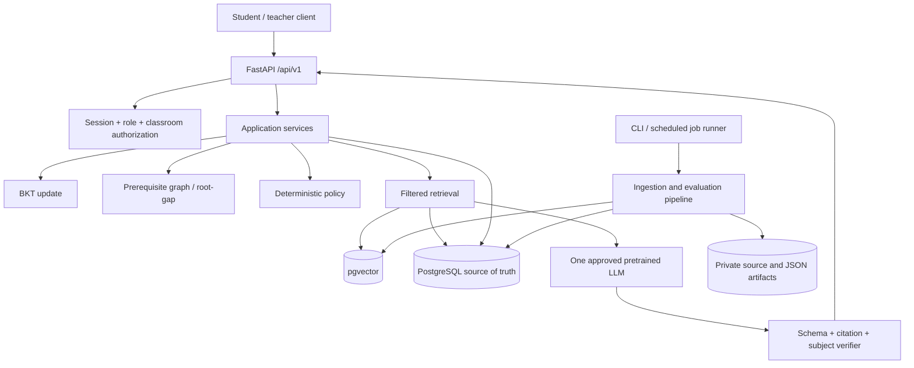

# ConceptTrail architecture specification

## 1. Overall shape

Use one FastAPI modular monolith with PostgreSQL as the system of record and pgvector for the selected vector storage path. Python CLI/background stages profile/clean/validate teammate CSVs, acquire permitted sources, extract and structure content, validate it and publish reviewed records. User inputs arrive through `resources/textbook_pdfs/` and `resources/teammate_csv/incoming/`. The user is building the frontend separately. Claude Code must not create or modify frontend code. It may inspect any existing UI read-only and must provide stable REST/OpenAPI contracts and a frontend integration guide.

## 2. Runtime architecture

## 3. Core module ownership

| Module | Owns | Must not own |
|---|---|---|
| `app/api/v1` | HTTP validation, session dependency, authorization, service invocation and status mapping | SQL joins, BKT equations, graph traversal and provider SDK calls |
| `app/core` | settings, auth primitives, redacted logging and typed errors | learning policies or content generation |
| `app/db` | SQLAlchemy 2.x models, request-scoped sessions, repositories and Alembic | public DTOs or model prompts |
| `app/schemas` | Pydantic v2 request/response and model-output schemas | database connection management |
| `app/services/bkt_service` | pure BKT update and state validation | LLM calls or question generation |
| `app/services/prerequisite_graph` | edge direction, DAG validation and root-gap candidates | chapter extraction |
| `app/services/policy_engine` | versioned deterministic actions and reason codes | model-generated decisions |
| `app/services/retrieval_service` | rights/status/class/subject/version/language-filtered search and source refs | final prose or invented citations |
| `app/services/llm_provider` | provider adapter, timeouts and tested transient fallback | authorization, grading or DB writes |
| `app/services/answer_verifier` | schema, citation and subject-specific checks | unbounded interpretation of arbitrary generated code |
| `app/services/bell_ringer_service` | evidence aggregation and draft recipe | publishing without teacher review |
| `data_pipeline` | offline source intake, extraction, cleaning, structuring, QC, derived CSVs and publish | synchronous API serving |

## 4. Synchronous vs background operations

Synchronous: authentication, curriculum/topic lookup, question fetch, bounded doubt retrieval/generation, attempt scoring, idempotent persistence and BKT update. Background/CLI: source acquisition, PDF extraction/OCR, bulk content structuring, KC/edge/question generation, embeddings/rebuilds, BKT fitting, full evaluation, coverage reports and scheduled Bell-Ringer draft candidates. Each job is idempotent, versioned and has status/progress/error metadata.

## 5. Content release lifecycle

`discovered -> source_review_pending -> approved_for_use -> acquired -> extracted -> cleaned -> validated -> structured -> human_reviewed -> indexed -> published`.

Blocked states include `missing_source`, `permission_required`, `extraction_failed`, `metadata_missing`, `review_rejected`, `out_of_date` and `not_in_current_scope`. Failed/blocked items remain in coverage reporting. Do not overwrite the last known-good index before a new generation passes.

## 6. Retrieval contract

Input: query plus server-resolved learner/class/subject/course/curriculum/language and optional KC. Hard filters: class, subject, curriculum version, course/language, source-use rights, validation/review/publication status and index generation. Return chunk text and IDs plus source/page locator resolved via `content_unit` and `source_document`; the `embedding_chunk` table itself must retain the exact nine-field ERD contract.

Use keyword + dense retrieval only after benchmarked; retrieval is never a substitute for rights checks or source review. Citations are assembled from records, not generated by the LLM.

## 7. BKT/attempt consistency

The server grades a canonical question version, inserts an attempt with a unique idempotency key and updates eligible `student_kc_state` values in the same transaction. One overall correctness value must not be blindly replicated to every KC mapping. For multi-KC questions, require KC-specific evidence; otherwise use only a reviewed primary KC or exclude from BKT. Persist the BKT config version.

## 8. Bell-Ringer persistence gap

The current 26-table ERD has classroom, enrollment, teacher assignment and ingestion/job tables, but no Bell-Ringer draft/activity/approval entity. The service can calculate a draft candidate and enforce the coverage gate; durable draft/edit/approve/skip history needs an owner-approved schema migration. Do not overload `note` or `ingestion_job` for activity state.

## 9. Dependency direction

`api -> schemas/core/services -> repositories -> ORM/session -> PostgreSQL`. Pure services may depend on domain schemas but not on FastAPI. Provider adapters are called by the LLM service only. Pipeline modules may import shared schemas and DB publish adapters, but API routes never import pipeline stage implementations. Keep this dependency graph acyclic.
